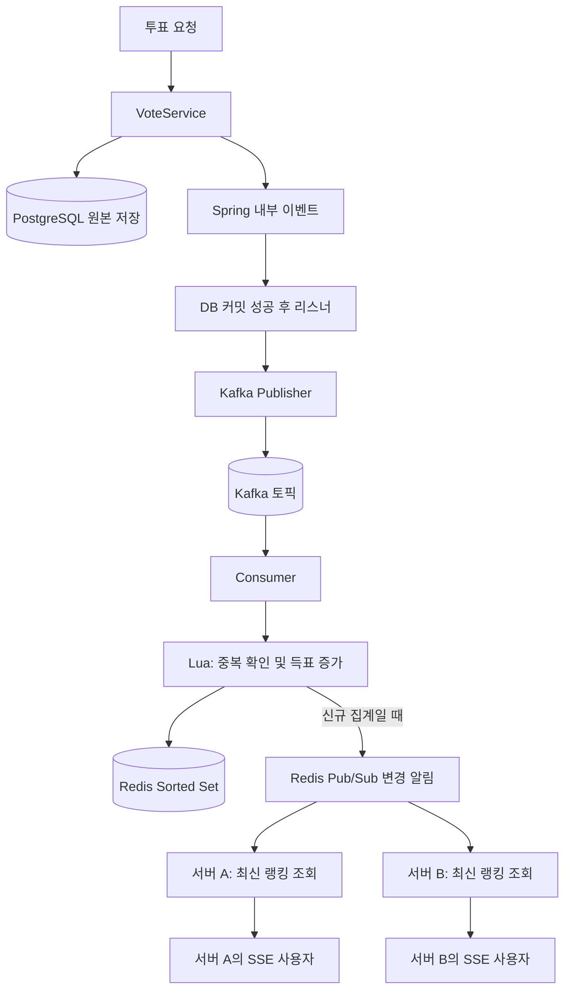

# Live Lunch Choice

점심 메뉴 후보를 등록하고 투표하면, 후보별 득표 수와 순위를 확인할 수 있는 학습용 웹 애플리케이션입니다.

이 프로젝트는 실제 서비스의 대규모 트래픽 문제에서 출발하지 않았습니다. **Kafka와 Redis가 어떤 문제를 해결하고, 그 대가로 어떤 복잡성을 만드는지 직접 구현하고 실험하기 위해** 시작했습니다. 같은 투표 기능을 DB·폴링, DB·SSE, Kafka·Redis·SSE로 구성하며 기술 선택의 근거를 비교합니다.

> 작성 기준: 2026-10-20. 기능 구현과 집계 조회 비교는 진행됐습니다. 실제 투표부터 Kafka 집계와 SSE 전달까지 이어지는 전체 경로의 처리 용량 실험은 아직 완료되지 않았습니다. 이 문서에서는 구현된 기능, 관측한 결과, 후속 계획을 구분합니다.

## 1. 어떤 프로그램인가

사용자는 메뉴 후보를 추가하고, 후보 중 하나에 투표한 뒤 현재 순위를 확인할 수 있습니다.

- 후보 등록과 목록 조회
- 테스트용 사용자 ID를 이용한 투표 등록 및 사용자당 한 표 제한
- 후보별 득표 수와 순위 조회
- 폴링 또는 SSE를 이용한 결과 갱신
- Redis 집계 시 동일 이벤트의 중복 반영 방지
- 다중 애플리케이션 서버에 연결된 SSE 사용자에게 변경 전파
- 실험용 Kafka Consumer 중단·재개 기능

프론트엔드는 Spring Boot의 정적 리소스인 HTML·CSS·JavaScript로 구성했습니다. 후보 목록과 랭킹 데이터를 결합해 아직 투표가 없는 후보도 0표로 표시합니다. 실제 로그인·인증, 투표 변경, 여러 투표방 운영은 현재 범위에 포함하지 않습니다. 테스트용 사용자 ID의 중복 제한은 인증이나 부정 투표 방지 기능을 대신하지 않습니다.

## 2. 왜 만들었는가

처음부터 필요한 제품 아이디어가 있었던 것은 아닙니다. Kafka를 제대로 사용해 보고 싶었고, Redis를 단순한 외부 저장소 외에도 Sorted Set, Pub/Sub, Lua 스크립트에 활용해 보고 싶었습니다.

주문 처리처럼 실패와 보상 흐름이 복잡한 프로젝트를 시작하기 전에, 작은 투표 프로그램으로 이벤트가 이동하는 과정을 관찰하기로 했습니다. 후보와 투표라는 단순한 도메인 덕분에 저장, 이벤트 발행, 집계, 화면 전달을 나누어 이해할 수 있었습니다.

학습 질문도 구현하면서 구체화됐습니다.

1. DB 저장과 Kafka 이벤트 발행의 순서를 어떻게 정해야 하는가?
2. Producer의 발행 성공과 Consumer의 처리 성공은 어떻게 다른가?
3. 같은 이벤트를 다시 받아도 집계가 중복되지 않게 하려면 무엇이 필요한가?
4. 여러 서버에 연결된 사용자에게 변경을 어떻게 전달하는가?
5. 기술을 추가한 구조가 단순한 구조보다 유리한 조건은 무엇인가?

## 3. 어떻게 계획하고 진행했는가

처음에는 기능 하나를 구현하고 작동 원리를 확인한 뒤 다음 단계로 넘어갔습니다. 익숙한 Controller → Service → Repository 계층을 유지했고, 기능 구현과 실험을 통해 필요한 분리를 추가했습니다.

| 단계 | 수행 내용 | 확인하려던 내용 |
|---|---|---|
| 기본 도메인 | 후보 등록·조회, 투표 저장, DB 결과 집계 | 투표 데이터와 API의 기준 동작 |
| Kafka 연결 | 커밋 후 이벤트 발행, Producer·Consumer 로그 | 접수와 후속 처리의 분리 |
| 소비 중단 실험 | Consumer를 멈춘 상태에서 발행 후 재개 | 발행 성공과 소비 완료의 차이 |
| Redis 집계 | Sorted Set 증가·순위 조회 | 매 조회 재집계 대신 결과를 미리 유지 |
| 중복 방지 | eventId와 Lua 스크립트 | 동시 중복 이벤트의 이중 집계 방지 |
| 결과 전달 | Redis Pub/Sub과 SSE | 서버 간 알림과 브라우저 전달의 구분 |
| 다중 서버 | 두 서버에 각각 SSE 연결 | 어느 서버에서 투표해도 변경 전달 |
| 비교 모드·화면 | polling/realtime 분리, 정적 UI | 직접 사용하고 구조별 동작 확인 |
| 실험 재설계 | DB·SSE 기준 추가, 누적 데이터별 조회 비교 | 전달 방식과 집계 설계의 효과 분리 |
| 후속 실험 | 실제 투표·집계·SSE 부하 계획 | 전체 처리 용량과 적체 해소 확인 — 미완료 |

설계와 학습 내용을 논의하는 과정, 구현과 검증을 수행하는 과정은 문서로 연결했습니다. 선택 이유는 [설계 결정 기록](docs/DESIGN_DECISIONS.md), 구현·검증 상태는 [진행 기록](docs/PROGRESS.md)에 남깁니다.

## 4. 기술과 책임 분리

| 기술 | 사용 목적 |
|---|---|
| Java 17 / Spring Boot / Spring MVC | API와 애플리케이션 구성 |
| JPA / PostgreSQL | 후보와 투표 원본 저장, DB 집계 |
| Kafka | 투표 이벤트 전달·보관, 후속 처리 분리 |
| Redis Sorted Set | 후보별 득표 수와 정렬된 결과 유지 |
| Redis Set / Lua | 처리한 이벤트 확인과 점수 증가를 함께 실행 |
| Redis Pub/Sub | 여러 애플리케이션 서버에 변경 알림 |
| SSE | 서버에서 브라우저로 랭킹 스냅샷 전달 |
| H2 / Testcontainers | 일반 테스트와 실제 인프라 통합 검증 |
| HTML / CSS / JavaScript | 별도 프론트 서버 없는 사용 화면 |

핵심 서비스의 책임은 다음과 같습니다.

- `VoteService`: 후보 확인, 투표 저장, DB 결과 집계, Spring 내부 이벤트 발행
- `VoteRealtimeService`: Redis 집계와 신규 집계 시 알림 발행
- `VoteRankingRedis`: Sorted Set 조회와 Lua 실행
- Kafka Publisher / Consumer: 이벤트 전송과 수신 후 집계 서비스 호출
- `RankingSource`: DB와 Redis 랭킹 조회를 공통 SSE 전송부에 연결
- `VoteRankingSseService`: 연결 관리, 초기 결과 전송, 변경 브로드캐스트

설정은 YAML로 작성하고 처리 모드를 프로필로 구분합니다. `db-sse`는 비교 실험용으로 추가했으며, 기존 정적 화면의 모드 지원은 `polling`과 `realtime`입니다.

## 5. 세 가지 구조

### A. DB + 폴링 (`polling`)

```text
투표 요청 → PostgreSQL 저장
브라우저 → 주기적 결과 요청 → DB 집계 → 응답 → 화면 갱신
```

브라우저는 결과 응답을 받은 뒤 약 2초 후 다시 조회합니다. Kafka와 Redis를 사용하지 않습니다.

구현과 운영이 단순하고 최신 상태를 다시 조회하기 쉽습니다. 여러 변경을 다음 조회 결과 하나로 보여줄 수 있습니다. 반면 변경이 없어도 조회하며, 결과 갱신에는 다음 조회까지의 대기 시간이 생깁니다. 현재 구현처럼 조회마다 원본 투표를 집계하면 데이터와 조회량 증가가 DB 부담으로 이어질 수 있습니다.

### B. DB + SSE (`db-sse`)

```text
투표 요청 → PostgreSQL 커밋 → 로컬 유한 작업 큐
                               ↓
                         DB 집계 → SSE
```

Kafka·Redis 없이 실시간 전달을 구현한 비교 기준입니다. 커밋 이후 작업은 별도 worker에서 처리하고, 한 알림마다 한 번 집계한 결과를 연결된 사용자들에게 보냅니다. 사용자 수만큼 같은 집계 쿼리를 반복하지 않습니다.

로컬 큐를 사용한 이유는 HTTP 요청 스레드가 모든 집계·전송을 기다리는 차이를 Kafka의 장점으로 오해하지 않기 위해서입니다. 실험 기본값은 worker 1개, 큐 용량 1,024개입니다.

폴링 대기 없이 전달할 수 있지만 원본 데이터 재집계 비용은 남습니다. 큐가 가득 차면 알림 작업이 거절될 수 있고, 프로세스 메모리의 큐는 영속적인 이벤트 보관을 보장하지 않습니다. 이 모드에는 서버 간 변경 전파도 구현하지 않았습니다.

### C. Kafka + Redis + SSE (`realtime`)



PostgreSQL은 투표 원본을 보관합니다. Redis는 이벤트로 갱신되는 집계 결과를 보관합니다. 투표 저장 성공과 Redis 반영 완료 사이에는 시간 차이가 있을 수 있습니다.

Kafka는 이벤트를 전달하고 보관하며, Redis는 집계 결과를 유지합니다. Pub/Sub은 서버들에 변경을 알리고, SSE는 각 서버의 브라우저 연결에 결과를 전송합니다. 각각의 역할은 서로 다릅니다.

## 6. 주요 설계 선택과 이유

### DB 커밋 후 Kafka 발행

투표 저장 트랜잭션 안에서 Spring 내부 이벤트를 발행하고, `AFTER_COMMIT` 리스너에서 Kafka Publisher를 호출합니다. DB가 롤백됐는데 Kafka 이벤트만 먼저 전달되는 경우를 막기 위한 순서입니다.

다만 DB와 Kafka가 하나의 원자적인 트랜잭션이 된 것은 아닙니다. DB 커밋 후 발행 전에 프로세스가 종료되거나 최종 발행에 실패하면 이벤트가 누락될 수 있습니다. 현재 Outbox와 영속적인 재발행은 구현하지 않았습니다.

Producer의 전송 완료는 설정된 Kafka 확인 조건에 따른 결과입니다. Consumer 수신, Redis 집계 완료, SSE 수신과는 구분해서 확인합니다.

### Sorted Set과 조회 계약

랭킹 키의 member는 후보 ID, score는 득표 수입니다. 이벤트 처리 시 점수를 증가시키고 조회 시 점수 내림차순으로 읽습니다.

초기에는 Redis 결과를 Map으로 바꾸고 DB 후보 목록과 합친 뒤 Java에서 다시 정렬하는 방법도 논의했습니다. 하지만 이미 Redis가 유지하는 순서를 다시 계산할 필요가 없었습니다. 최종적으로 Redis 조회 순서대로 `candidateId/voteCount` 목록을 반환하고, 이름과 0표 후보는 프론트에서 후보 목록과 결합하도록 정했습니다.

이 덕분에 Redis 랭킹 조회 경로에 이름을 붙이기 위한 DB 접근을 넣지 않았습니다. 동점은 Redis의 기본 조회 순서를 유지하며 숫자 후보 ID 오름차순으로 보장하지 않습니다.

### Lua를 이용한 중복 집계 방지

단순히 eventId를 확인한 뒤 점수를 증가시키면, 동시 처리 사이에 다른 요청이 끼어들 수 있습니다. 하나의 Lua 스크립트에서 처리한 eventId 확인, 점수 증가, 처리 표시를 실행하도록 했습니다.

이 설계는 정상 실행에서 명령 사이에 다른 요청이 끼어드는 경쟁 상태와 중복 이벤트 집계를 다룹니다. Lua 실행 중 오류의 자동 롤백이나 Redis 장애를 포함한 전체 시스템의 exactly-once를 보장하는 설계는 아닙니다. 이번 프로젝트에서는 그 범위까지 고도화하지 않기로 했습니다.

### Redis Pub/Sub 선택

모든 SSE 서버가 동일한 변경 알림을 받아야 합니다. Kafka의 같은 Consumer Group은 작업을 나누므로, 모든 서버가 같은 알림을 받도록 구성하려면 서버별 그룹 등의 관리가 필요합니다.

이미 Redis로 집계하고 있고 화면 알림은 재연결 시 최신 상태로 복구할 수 있다는 전제에서, 같은 채널을 구독하는 Redis Pub/Sub을 선택했습니다. 단일 서버라면 직접 SSE 전송도 가능합니다. Pub/Sub의 목적은 서버 간 변경 전파입니다.

Pub/Sub은 놓친 알림을 재생하지 않습니다. 집계 성공과 알림 발행도 별개라서, 점수 반영 후 알림만 실패하는 경우는 현재 별도 보상하지 않습니다.

### 전체 랭킹 스냅샷 전송

SSE에서는 증분을 클라이언트가 누적하기보다 최신 목록으로 교체하도록 했습니다. 초기 연결과 재접속에도 현재 랭킹을 보냅니다.

클라이언트 처리는 단순해지지만 투표가 많으면 같은 사용자에게 많은 전체 목록을 전송합니다. Redis를 사용한다고 전송량이 자동으로 줄어들지는 않습니다. 전송량은 payload, 변경 빈도, 연결 수와 전송 정책의 영향을 받습니다.

## 7. 구조별 장단점

| 관점 | DB + 폴링 | DB + SSE | Kafka + Redis + SSE |
|---|---|---|---|
| 구성·운영 | 가장 단순 | SSE와 로컬 작업 큐 관리 필요 | 브로커·Redis·소비·연결 관리 필요 |
| 화면 갱신 | 다음 조회까지 대기 | 커밋 후 집계·전송 | 커밋 후 이벤트 전달·집계·전송 |
| 집계 비용 | 조회마다 원본 재집계 | 알림마다 원본 재집계 | 이벤트마다 점수 갱신, 조회는 집계 결과 읽기 |
| 변경이 많은 경우 | 여러 변경을 한 응답에 반영 | 변경마다 전송 비용 증가 | 변경마다 집계·알림·전송 비용 증가 |
| 후속 처리 대기 | 현재 별도 집계 큐 없음 | 유한 메모리 큐 | Kafka에 미소비 이벤트 보관 가능 |
| 다중 서버 알림 | 각 클라이언트가 DB 조회 | 현재 별도 구현 없음 | Redis Pub/Sub으로 전파 |
| 추가 일관성 문제 | 주로 DB 트랜잭션 | 저장 성공 후 알림 실패 가능 | DB·Kafka·Redis·알림 사이 실패 구간 존재 |
| 적합성 판단 | 지연을 허용하고 단순함이 중요할 때 | 작은 규모에서 빠른 전달이 필요할 때 | 집계·후속 처리 분리 요구와 운영 비용을 함께 검토할 때 |

어느 구조가 항상 우수한 것은 아닙니다. 이 프로젝트의 기능만 보면 DB와 SSE로도 구현할 수 있습니다. Kafka·Redis를 선택할 이유는 실제 요구사항과 측정 결과로 설명해야 합니다.

## 8. 실험을 어떻게 바꿨는가

첫 비교는 DB·폴링과 Kafka·Redis·SSE였습니다. 그러나 확인하고 싶었던 것은 높은 부하에서 처리 구조의 차이였는데, 결과에는 폴링 주기와 SSE의 전달 차이가 크게 섞였습니다.

따라서 기존 결과는 새 성능 주장의 근거에서 제외했습니다. 측정 원본은 남기되 해당 결과로 Kafka나 Redis의 처리 용량을 주장하지 않기로 했습니다.

새 실험은 두 단계로 나눴습니다.

1. **조회 진단:** 누적 투표 수와 조회 요청량을 바꾸며 DB 재집계와 Redis 사전집계 조회 비교.
2. **전체 경로:** 두 방식 모두 SSE를 사용하고 실제 투표 접수부터 집계·전달까지 비교.

초기 재실험에서는 발생기가 목표 요청을 보내지 못하고, Kafka lag 측정용 JVM 실행이 자원 측정을 교란하는 문제도 발견했습니다. 요청 미발행과 서버 실패를 분리하고 관측기를 보완했습니다. 이후 경미한 경고는 남기면서 진행하되, 심각한 응답 불능에서는 부하를 중단하도록 조정했습니다. 경고를 허용해 실행을 계속하는 것과 성능 기준 통과는 구분했습니다.

## 9. 실제로 확인한 결과

### 기능 검증

Consumer 중단·재개, Lua 중복 방지, Pub/Sub과 SSE 전달, 두 애플리케이션 서버의 변경 전파를 확인했습니다. DB·SSE와 Kafka·Redis·SSE 비교 구현에서는 각 14표의 소부하 동작을 검증했습니다. 이는 기능 확인이며 고부하 처리 용량 검증은 아닙니다.

### 조회 진단: 데이터가 커질 때의 차이

다음은 2026-10-19 `resume1` 실행 결과입니다. 후보 4개, PostgreSQL 2CPU·1GiB, 앱 heap 512MiB·DB pool 10 조건이며 같은 노트북에서 실행했습니다. 조회 실험에는 신규 투표 쓰기와 SSE 전송이 없습니다. 각 조건은 워밍업 5초, 측정 30초 계획이었고 마지막 DB 조건은 조기 중단됐습니다.

| 누적 투표 | 초당 조회 | DB 집계 API p95 | Redis 조회 API p95 |
|---|---:|---:|---:|
| 1만 | 10 | 15.25ms | 10.51ms |
| 1만 | 200 | 8.05ms | 3.60ms |
| 10만 | 10 | 34.35ms | 8.95ms |
| 10만 | 200 | 9,305.81ms | 3.34ms |
| 100만 | 10 | 1,339.62ms | 11.49ms |
| 100만 | 50 | 대부분 실패·조기 중단 | 5.76ms |

실패한 조건의 API 지연에는 실패 요청의 대기 시간도 포함됩니다. SQL 하나의 실행 시간이나 성공 응답만의 지연으로 읽으면 안 됩니다.

- **10만 표·200조회/s:** DB는 예정 6,000건 중 4,566건 발행, 4,502건 성공. 진행 중 요청이 1,024개까지 쌓였습니다. Redis는 6,000건 모두 성공했습니다.
- **100만 표·50조회/s:** DB는 측정 구간 1,205건 발행 중 10건 성공 후 중단됐습니다. Redis는 정상 30초 동안 1,500건 모두 성공했습니다.
- 실패한 DB 조건에서 CPU 2코어 예산 소진과 실행 제한, 커넥션 10개 점유, 대기자 최대 190개, 30초 커넥션 획득 타임아웃이 관측됐습니다.

현재 설계에서는 누적 투표 기록을 매 조회 재집계하는 비용이 커졌습니다. 반면 Redis는 누적 투표가 100만 건이어도 후보 4개의 집계 결과를 읽습니다.

**이 결과는 DB 원본 재집계와 Redis 사전집계 조회의 차이를 보여줍니다.** Sorted Set의 정렬 기능만의 효과나 DB 기술 일반의 한계는 아닙니다. DB에 집계 테이블을 두는 방식은 이번 비교 대상이 아니었습니다.

### 아직 말할 수 없는 것

- Kafka 도입으로 전체 시스템의 최대 처리량이 증가했다는 결론
- 실제 투표·집계·SSE 경로가 높은 부하에서도 지연 없이 유지된다는 결론
- 정확한 최대 처리량과 실패 경계 — 중간 부하와 경계 반복 측정이 남아 있음
- 다른 하드웨어나 운영 환경에서도 같은 숫자가 나온다는 보장
- 장애 전반에서 이벤트가 유실되지 않거나 정확히 한 번 처리된다는 보장

상세 증거와 제약은 [조회 실험 결과](docs/LOAD_TEST_CAPACITY_RESULT.md)의 최신 `resume1` 부분에 기록했습니다. 앞부분은 이전 시도의 이력이므로 최신 결과와 구분해야 합니다.

## 10. 구현하면서 배운 점과 범위를 줄인 이유

### 기술을 추가할수록 해결해야 하는 상태도 늘어난다

DB 저장 성공, Kafka 발행 성공, Consumer 처리 완료, Redis 집계 완료, 브라우저 수신은 서로 다른 상태였습니다. 비동기 구조를 이해하려면 각 단계의 성공과 실패를 구분해서 기록해야 했습니다.

### 실시간 화면과 Kafka는 같은 요구가 아니다

SSE만으로도 DB 기반 실시간 화면을 만들 수 있습니다. Kafka를 사용할 이유는 이벤트 보관과 후속 처리 분리 등의 요구에서 찾아야 합니다. 화면이 빨리 바뀌었다는 사실만으로 Kafka의 필요성을 설명할 수는 없습니다.

### 멱등성에는 원자적인 처리 범위가 중요하다

이벤트 ID를 저장하는 것만으로는 충분하지 않았습니다. 확인·증가·처리 표시가 분리되면 경쟁 상태가 생길 수 있었습니다. Lua로 필요한 명령을 묶되, 이것이 모든 장애를 해결한다는 의미는 아니라는 범위도 정했습니다.

### 종료·초기화 기능을 만들지 않은 이유

투표 초기화를 고민하면서 늦게 도착한 Kafka 이벤트가 초기화 이후 점수를 다시 올릴 수 있다는 문제를 발견했습니다. 투표 접수 중단, 진행 중 요청, 아직 발행되지 않은 이벤트, 미소비 이벤트 등을 고려해야 했습니다. Kafka lag가 0이라는 값 하나로 모든 작업 종료를 증명할 수도 없습니다.

하지만 이 프로그램에서 투표 생명주기를 그 수준까지 고도화하는 것은 현재 학습 목표를 넘었습니다. 종료·초기화 API는 구현하지 않고, 실험 데이터의 준비와 복원은 격리된 실험 도구에서 수행하기로 했습니다.

### 실험은 기술을 정당화하기 위해 만드는 것이 아니다

원하는 기술이 이기는 결과를 만드는 것보다, 비교 대상이 같은 요구를 수행하는지 먼저 확인해야 했습니다. 첫 비교의 전달 방식 차이를 제거하고 DB·SSE 기준을 추가한 이유도 이것입니다. 추가 구성 요소의 비용과 아직 증명하지 못한 부분까지 함께 설명하는 것이 이 프로젝트의 회고 방향입니다.

## 11. 회고에서 생각한 대안: Redis 우선 처리와 DB 배치 반영

현재 가장 관심 있는 대안은 Kafka를 제거하고 Redis에서 투표 중복 확인과 Sorted Set 집계를 처리한 뒤, Pub/Sub과 SSE로 결과를 전달하는 구조입니다. DB에는 Redis의 내용을 주기적으로 배치 반영합니다.

```text
투표 요청 → Redis 중복 확인·득표 증가 → Pub/Sub → 각 서버 → SSE
                         ↓
                 주기적 배치 → PostgreSQL
```

이 프로그램처럼 실시간 집계가 중심인 경우, 매 투표마다 DB에 쓰고 Kafka를 거치는 것보다 요청 경로와 운영 구성을 줄일 수 있다고 생각했습니다. 후보별 누적 점수를 묶어 저장한다면 여러 투표를 소수의 DB 갱신으로 반영할 가능성도 있습니다.

**이는 효율이 가장 높다고 검증한 결론이 아니라, 다음 설계 대안에 대한 가설입니다. 현재 구현하거나 부하 비교한 구조는 아닙니다.** 효율을 요청 지연·DB 작업량·운영 비용 중 무엇으로 평가하는지와 허용할 데이터 손실 범위에 따라 판단이 달라집니다. 실험 결과를 본 이력을 바탕으로 생각한 대안이며 추가 구현을 확정한 것은 아닙니다.

### 기대하는 이점

- 매 투표의 동기 DB 쓰기를 요청 경로에서 제외할 수 있습니다.
- Kafka 발행·소비와 관련 운영 구성을 줄일 수 있습니다.
- Redis에 유지한 점수로 실시간 조회와 서버 간 알림을 처리할 수 있습니다.
- 후보별 집계 결과만 저장한다면 배치로 DB 갱신 횟수를 줄일 수 있습니다.

### 먼저 결정해야 할 데이터의 의미

현재 시스템은 PostgreSQL에 개별 투표 원본을 저장합니다. 대안에서는 DB 배치가 완료되기 전까지 Redis가 최신 투표 상태를 책임집니다. 이는 캐시 추가가 아니라 **저장의 기준과 성공 응답의 의미를 바꾸는 선택**입니다.

Sorted Set의 후보별 점수만으로는 누가 어느 후보에 투표했는지 복원할 수 없습니다. 현재의 사용자당 한 표 제한을 유지하려면 사용자별 투표 상태도 별도로 저장해야 합니다. DB에도 개별 투표 이력이 필요하다면 그 원본을 Redis에 보관해 배치로 옮기는 설계가 추가되어야 합니다. 이 경우 배치는 쓰기를 묶을 수 있지만 개별 투표 행을 저장하는 총작업까지 없애지는 않습니다.

### 함께 받아들여야 하는 비용

| 고려사항 | 의미 |
|---|---|
| DB 반영 지연 | DB만 조회하면 배치 주기만큼 오래된 상태를 볼 수 있음 |
| 배치 전 데이터 손실 | Redis의 영속화·복구 정책에 따라 이미 성공 응답한 투표를 잃을 수 있어 허용 범위를 정해야 함 |
| 배치 재시도·동시 실행 | 같은 점수를 중복 가산하거나 오래된 스냅샷이 새 값을 덮지 않도록 반영 기준이 필요함 |
| 개별 투표 원본 | 점수만 저장할지, 사용자별 이력까지 보존할지 요구사항을 먼저 정해야 함 |
| 알림 누락 | Pub/Sub은 영속적인 작업 큐가 아니므로 DB 배치 대상을 Pub/Sub 수신에만 의존하면 안 됨 |
| 전송량 | 같은 빈도로 같은 SSE 스냅샷을 보내면 Kafka 제거만으로 브라우저 전송량이 줄지는 않음 |

예를 들어 후보별 누적값을 배치로 반영하는 방법과 개별 투표를 배치 INSERT하는 방법은 보존하는 정보와 비용이 다릅니다. 배치 동안에도 새 투표가 들어올 수 있으므로 읽은 데이터를 바로 지우거나 초기화하는 방식도 피해야 합니다.

이 대안을 통해 얻은 관점은 모든 투표에 같은 수준의 저장 보장이 필요한지부터 정해야 한다는 것입니다. 일시적인 점심 메뉴 집계에서 허용할 수 있는 지연·손실 범위가 명확하다면 단순한 Redis 중심 구조를 검토할 수 있습니다. 개별 투표 이력과 복구가 중요하다면 그 요구까지 포함한 비용으로 현재 구조와 비교해야 합니다.

## 12. 검증하지 못한 후속 과제

다음 항목은 계획했지만 완료하지 못한 검증입니다. 최신 진행 기록에 따라 부하 도구·계측 코드는 정리됐고 후속 실험은 자동 진행하지 않습니다.

- 실제 투표 요청을 단계적으로 늘려 접수·집계·SSE의 전체 처리 지연과 정확성 비교
- 순간적인 투표 집중 후 Kafka lag 또는 로컬 큐가 해소되는 시간 확인
- Consumer 중단 중 실제 투표를 받고 재개한 뒤 원본·집계·SSE 결과 대조
- 같은 투표량에서 SSE 관람자 수를 늘려 전송 병목 확인

HTTP 응답이 빨라도 집계 지연이 계속 증가하면 지속 처리 기준을 만족한 것으로 보지 않습니다. 전체 A/B 구조의 차이와 Kafka의 이벤트 보관·소비 분리 역할은 별도로 분석할 예정입니다.

당시 계획은 [실제 이벤트 실험 인계](docs/LOAD_TEST_EVENT_PIPELINE_HANDOFF.md)에 이력으로 남아 있습니다. Outbox, 자동 보상, 운영용 종료·초기화, 고가용성 구성은 현재 구현 범위 밖입니다.

## 13. 실행·검증 안내와 관련 기록

Java 17과 PostgreSQL이 필요하며, `realtime`에는 Kafka와 Redis도 필요합니다. [.env.example](.env.example)의 항목을 참고해 별도 개발 DB 정보를 설정합니다. 비밀값은 커밋하지 않습니다. 기본 처리 모드는 `realtime`이며 `APP_PROFILE`로 `polling` 또는 `db-sse`를 선택할 수 있습니다. 명시적으로 지정한 Spring 활성 프로필과 충돌하지 않도록 확인합니다.

현재 개발 설정은 JPA `ddl-auto: update`를 사용합니다. 운영용 스키마 마이그레이션 구성은 아닙니다. 모드 전환 시 기존 DB 투표가 Redis에 자동으로 반영되지 않으므로, 동일 데이터 비교에는 격리된 시드 준비가 필요합니다.

```bash
./gradlew bootRun
```

일반 테스트와 실제 인프라 통합 테스트는 분리했습니다. 통합 테스트는 Docker가 필요합니다.

```bash
./gradlew test
./gradlew redisTest
```

이 README 작성 시 테스트를 새로 실행한 것은 아닙니다. 최근 일반 83건 통과와 앞선 통합 9건 통과 등 실행 시점별 결과는 진행 기록에서 확인할 수 있습니다. 로컬 작업 중인 부하 도구·계측 변경과 커밋된 서비스 코드의 범위도 구분합니다.

| 문서 | 내용 |
|---|---|
| [진행 기록](docs/PROGRESS.md) | 현재 구현·검증·미완료 상태 |
| [설계 결정](docs/DESIGN_DECISIONS.md) | 선택 이유와 변경 이력 |
| [Consumer 중단·재개 결과](docs/CONSUMER_STOP_RESUME_RESULT.md) | 발행과 소비 분리 실험 |
| [Redis·Pub/Sub·SSE 결과](docs/REDIS_PUBSUB_SSE_RESULT.md) | 집계와 전달 기능 검증 |
| [다중 서버 실험](docs/MULTI_SERVER_SSE_RESULT.md) | 서버 간 변경 전파 검증 |
| [집계 조회 실험](docs/LOAD_TEST_CAPACITY_RESULT.md) | 누적 데이터별 성능과 병목 |
| [후속 전체 경로 계획](docs/LOAD_TEST_EVENT_PIPELINE_HANDOFF.md) | 실제 투표·Kafka·SSE 부하 검증 |

이 프로젝트의 목표는 작은 투표 기능에 많은 기술을 넣었다는 사실을 보여주는 것이 아닙니다. 각 구성 요소가 맡는 일, 효과가 나타난 조건, 해결하지 않은 문제를 직접 설명할 수 있는 상태를 만드는 것입니다.
