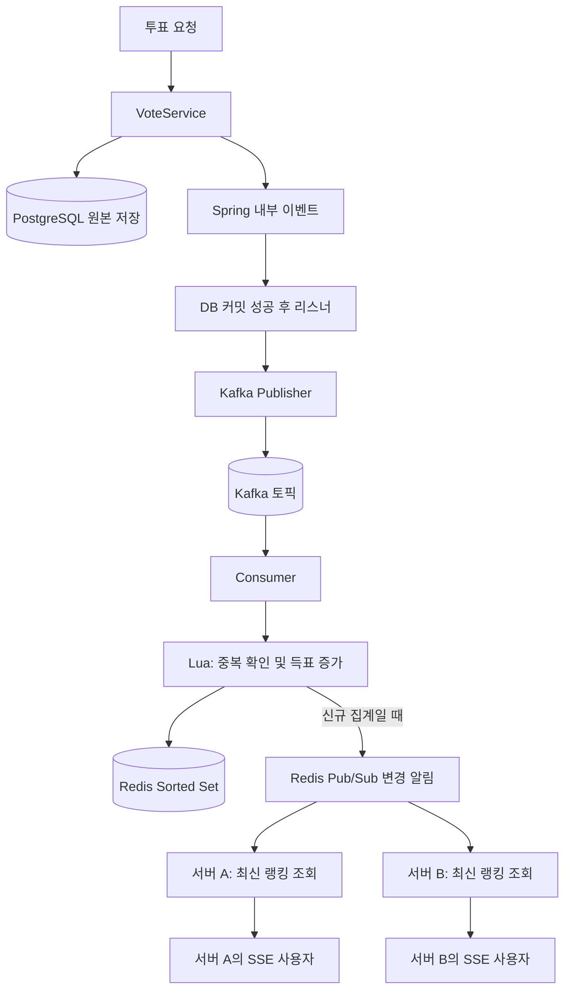

# 처리 구조와 기술별 역할

[프로젝트 소개와 회고](../README.md) · [실행 방법](GETTING_STARTED.md) · [구조](ARCHITECTURE.md) · [설계 판단](DESIGN_REVIEW.md) · [성능 실험](PERFORMANCE_REVIEW.md)

## 기술과 책임 분리

| 기술 | 사용 목적 |
|---|---|
| Java 17 / Spring Boot / Spring MVC | API와 애플리케이션 구성 |
| JPA / PostgreSQL | 후보와 투표 원본 저장, DB 집계 |
| Kafka | 투표 이벤트 전달·보관, 후속 처리 분리 |
| Redis Sorted Set | 후보별 득표 수와 정렬된 결과 유지 |
| Redis Set / Lua | 처리한 이벤트 확인과 점수 증가를 함께 실행 |
| Redis Pub/Sub | 여러 애플리케이션 서버에 변경 알림 |
| SSE | 서버에서 브라우저로 랭킹 스냅샷 전달 |
| H2 / Testcontainers | 일반 테스트와 실제 인프라 통합 검증 |
| HTML / CSS / JavaScript | 별도 프론트 서버 없는 사용 화면 |

핵심 서비스의 책임은 다음과 같습니다.

- `VoteService`: 후보 확인, 투표 저장, DB 결과 집계, Spring 내부 이벤트 발행
- `VoteRealtimeService`: Redis 집계와 신규 집계 시 알림 발행
- `VoteRankingRedis`: Sorted Set 조회와 Lua 실행
- Kafka Publisher / Consumer: 이벤트 전송과 수신 후 집계 서비스 호출
- `RankingSource`: DB와 Redis 랭킹 조회를 공통 SSE 전송부에 연결
- `VoteRankingSseService`: 연결 관리, 초기 결과 전송, 변경 브로드캐스트

설정은 YAML로 작성하고 처리 모드를 프로필로 구분합니다. `db-sse`는 비교 실험용으로 추가했으며, 기존 정적 화면의 모드 지원은 `polling`과 `realtime`입니다.

## 세 가지 구조

### A. DB + 폴링 (`polling`)

```text
투표 요청 → PostgreSQL 저장
브라우저 → 주기적 결과 요청 → DB 집계 → 응답 → 화면 갱신
```

브라우저는 결과 응답을 받은 뒤 약 2초 후 다시 조회합니다. Kafka와 Redis를 사용하지 않습니다.

구현과 운영이 단순하고 최신 상태를 다시 조회하기 쉽습니다. 여러 변경을 다음 조회 결과 하나로 보여줄 수 있습니다. 반면 변경이 없어도 조회하며, 결과 갱신에는 다음 조회까지의 대기 시간이 생깁니다. 현재 구현처럼 조회마다 원본 투표를 집계하면 데이터와 조회량 증가가 DB 부담으로 이어질 수 있습니다.

### B. DB + SSE (`db-sse`)

```text
투표 요청 → PostgreSQL 커밋 → 로컬 유한 작업 큐
                               ↓
                         DB 집계 → SSE
```

Kafka·Redis 없이 실시간 전달을 구현한 비교 기준입니다. 커밋 이후 작업은 별도 worker에서 처리하고, 한 알림마다 한 번 집계한 결과를 연결된 사용자들에게 보냅니다. 사용자 수만큼 같은 집계 쿼리를 반복하지 않습니다.

로컬 큐를 사용한 이유는 HTTP 요청 스레드가 모든 집계·전송을 기다리는 차이를 Kafka의 장점으로 오해하지 않기 위해서입니다. 실험 기본값은 worker 1개, 큐 용량 1,024개입니다.

폴링 대기 없이 전달할 수 있지만 원본 데이터 재집계 비용은 남습니다. 큐가 가득 차면 알림 작업이 거절될 수 있고, 프로세스 메모리의 큐는 영속적인 이벤트 보관을 보장하지 않습니다. 이 모드에는 서버 간 변경 전파도 구현하지 않았습니다.

### C. Kafka + Redis + SSE (`realtime`)



PostgreSQL은 투표 원본을 보관합니다. Redis는 이벤트로 갱신되는 집계 결과를 보관합니다. 투표 저장 성공과 Redis 반영 완료 사이에는 시간 차이가 있을 수 있습니다.

Kafka는 이벤트를 전달하고 보관하며, Redis는 집계 결과를 유지합니다. Pub/Sub은 서버들에 변경을 알리고, SSE는 각 서버의 브라우저 연결에 결과를 전송합니다. 각각의 역할은 서로 다릅니다.

## 구조별 장단점

| 관점 | DB + 폴링 | DB + SSE | Kafka + Redis + SSE |
|---|---|---|---|
| 구성·운영 | 가장 단순 | SSE와 로컬 작업 큐 관리 필요 | 브로커·Redis·소비·연결 관리 필요 |
| 화면 갱신 | 다음 조회까지 대기 | 커밋 후 집계·전송 | 커밋 후 이벤트 전달·집계·전송 |
| 집계 비용 | 조회마다 원본 재집계 | 알림마다 원본 재집계 | 이벤트마다 점수 갱신, 조회는 집계 결과 읽기 |
| 변경이 많은 경우 | 여러 변경을 한 응답에 반영 | 변경마다 전송 비용 증가 | 변경마다 집계·알림·전송 비용 증가 |
| 후속 처리 대기 | 현재 별도 집계 큐 없음 | 유한 메모리 큐 | Kafka에 미소비 이벤트 보관 가능 |
| 다중 서버 알림 | 각 클라이언트가 DB 조회 | 현재 별도 구현 없음 | Redis Pub/Sub으로 전파 |
| 추가 일관성 문제 | 주로 DB 트랜잭션 | 저장 성공 후 알림 실패 가능 | DB·Kafka·Redis·알림 사이 실패 구간 존재 |
| 적합성 판단 | 지연을 허용하고 단순함이 중요할 때 | 작은 규모에서 빠른 전달이 필요할 때 | 집계·후속 처리 분리 요구와 운영 비용을 함께 검토할 때 |

어느 구조가 항상 우수한 것은 아닙니다. 이 프로젝트의 기능만 보면 DB와 SSE로도 구현할 수 있습니다. Kafka·Redis를 선택할 이유는 실제 요구사항과 측정 결과로 설명해야 합니다.
